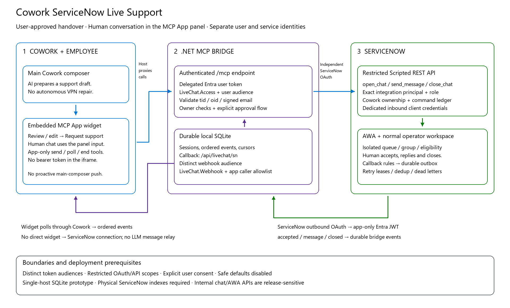

# Cowork ServiceNow Live Support

**Human IT support inside Cowork — from a reviewed request to a live ServiceNow conversation.**

Prepared **27 November 2026**, version **0.1.1**, as a self-contained, MIT-licensed
**Cowork plugin deployment kit**. This is the **Cowork MCP App**, not a SKILL.md
instruction set or the separate standard .NET skill. No publication, upload,
installation or live tenant change is performed by this preparation.

## Start here: deployment required

**Do not upload the gallery download directly. It is not click-and-run.**
The root manifest is a connector-only, nondeployable template: `example.invalid`
is not a hosted endpoint, and `REPLACE_WITH_OWNER_OAUTH_TOKEN_STORE_REFERENCE` is
not a working OAuth registration. OAuth remains mandatory; anonymous mode is not
an alternative. Sample AppId `7358720d-3113-4d7f-881f-32f4cc8f8a27` is a newly
generated, stable example UUID, not a real tenant deployment identity.

The gallery accepts the unpacked manifest/icons/resources structure and generates
a ZIP; its connector validation does not test endpoint availability or OAuth
wiring. Maintainers must still decide whether a deployment-required template fits
their gallery policy. Structural validation is not approval for direct installation.

1. Download and extract the kit. Keep its `LICENSE` and `NOTICE`.
2. Open `resources\deployment\README.md` (this complete guide travels in the ZIP).
   Work from **`resources\deployment`** for all build, publish and package commands.
3. Provision your approved host, ServiceNow configuration and OAuth registrations
   using the sequence below; none are provided by the gallery.
4. Generate a separate **three-file** target upload ZIP after deployment, with a
   target-owned stable AppId, explicit `-Version '0.1.1'`, actual MCP endpoint,
   real token-store reference and approved legal URLs. Do not reuse sample values.
5. Validate host/tenant policy and obtain deployment approval before manual upload.

The Windows/PowerShell scripts are **deployment-owner workstation tooling**,
not commands for Cowork's Linux execution container. At runtime Cowork uses only
the authenticated remote MCP connector and its embedded widget. The included .NET,
widget and ServiceNow sources are self-contained; no private repository access is
needed to build them. The private origin remains private.

| Artifact | Purpose |
| --- | --- |
| Gallery root `metadata.json`, `README.md` | Human catalog/page sidecars, excluded from generated download |
| Root `manifest.json`, `color.png`, `outline.png` | Nonfunctional connector template and generic icons |
| Root `LICENSE`, `NOTICE` | Distribution terms and attribution, included in download |
| `resources\deployment` | Complete owner-run backend/widget/ServiceNow source, tests and offline guide |
| Owner-generated `artifacts\package\cowork-sn.zip` | Separate configured three-file runtime upload, never part of this contribution |

## Purpose and experience

An employee asks Cowork for help, for example with a VPN connection. Cowork prepares
a support-summary **draft**. The employee reviews/edits it and selects **Request
support inside the embedded panel** before it is sent to ServiceNow. A human
representative accepts the request in the normal ServiceNow operator workspace.
The employee and representative then exchange messages and close the interaction.

This plugin **does not autonomously diagnose or repair the VPN**. The AI prepares
the handover; it is not the relay for the raw human conversation. Use the panel's
**Message IT support** input, not the main Cowork composer. The main composer
remains Cowork's AI conversation; the widget cannot replace it or proactively push
operator messages into it.

`start_live_chat` is model-visible and creates only a draft. Confirmation, sending,
polling and ending are app-only tools in a compatible MCP Apps host. Tool visibility
is presentation metadata, **not an authorization boundary**: every call still
requires delegated authentication and session-owner checks. The host must honor
MCP Apps visibility and the explicit in-panel approval flow.

## Architecture



[Editable Excalidraw source](docs/Cowork-ServiceNow-Architecture.excalidraw)
· [Scalable SVG](docs/Cowork-ServiceNow-Architecture.svg)

1. **Cowork → .NET MCP bridge:** the host proxies widget tool calls with the user's
   delegated Entra access token. The bridge checks issuer, signature, expiry,
   tenant, user audience, `LiveChat.Access`, and the signed requester identity.
   Sessions are bound to `tid` + `oid`; approved email mapping is not an arbitrary
   client-supplied identity.
2. **Bridge → ServiceNow:** a separate inbound OAuth **client-credentials**
   registration authenticates the bridge's dedicated integration user. Restricted
   Scripted REST `open_chat`, `send_message`, `close_chat` operations enforce the
   integration role, exact principal, Cowork ownership tags and command deduplication.
   The user access token is **not** forwarded to ServiceNow.
3. **ServiceNow → bridge:** callback rules capture accepted/message/closed events
   in a durable outbox. A separate outbound OAuth provider obtains an Entra
   **app-only JWT** for the distinct webhook audience. The bridge requires
   `LiveChat.Webhook`, an allowlisted application caller and no delegated `scp`.
4. **Bridge → widget:** `/api/livechat/sn` stores validated events in local SQLite.
   The widget polls through the host's authenticated MCP transport, rather than
   connecting directly to ServiceNow or receiving proactive main-chat messages.
   The command ledger prevents duplicate mutations; the outbox adds retries,
   conditional leases and dead-letter handling. SQLite preserves ordered events.

The iframe contains no bearer tokens or ServiceNow credentials. In the intended
host flow, app-only results stay in the panel rather than being relayed by the LLM.
Host behavior and transcript visibility must be verified for each supported host.

## What is included — and what you must provision

| Included in this source package | Deployment owner must supply/validate |
| --- | --- |
| .NET MCP bridge, SQLite store and tests | Approved HTTPS host, persistent local storage, TLS/proxy policy, backup/retention and operations |
| TypeScript MCP App widget, lockfile and tests | Compatible Cowork MCP Apps host, OAuth token-store reference, consent and permitted users |
| Manifest template and package generator | Stable target-owned AppId, version, approved MCP/legal URLs and actual upload approval |
| ServiceNow scripts, definition, generators and mocked tests | Licensed plugins, release-compatible native APIs/schema, target Global namespace and minimum runtime permissions |
| Disabled, create-only installer **template: 83 records** | Explicit target adaptation/review, elevated installation session, physical database indexes |
| Bridge role/ACL definitions, tables, callback rules and retry definition | Integration/requester/operator identities, inbound/outbound OAuth, queue/group/assignment/eligibility and all routing values |
| Architecture diagram, MIT license and operational guidance | Platform/dependency licensing review, support owner, privacy terms and production acceptance |

No tenant registrations, credentials, credential receivers, DPAPI files, configured
startup scripts, working tenant upload ZIP, runtime database, raw recordings or
private deployment evidence are bundled.

## Demonstrated scope and limitations

A fresh **26 November 2026, 2:06 synthetic side-by-side demonstration** recorded
draft review, explicit handover, normal operator acceptance, two-way human chat,
and operator closure with **Chat ended** in the widget. This is one successful
basic round trip, not proof of production reliability, interruption recovery,
cross-host availability or a repaired VPN. The finished video is available
separately from its owner; this compact source package intentionally omits media.

Important boundaries:

- One bridge process and **persistent local SQLite**, not shared SMB/NFS or
  multi-replica scale-out. Recovery/lease contention, backups and retention need
  target acceptance testing.
- Internal `sn_cs` chat APIs and AWA schemas are release-sensitive; this is not a
  vendor-supported generic ServiceNow connector.
- Widget polling normally runs every **4 seconds**, with bounded failure backoff
  up to 60 seconds and slower 15-second polling after closure for delayed events.
  Visibility/teardown/draft consent pause polling. Only ordered polling advances
  the cursor; sends and polls share a serialized rate budget. Host quotas apply.
- **Request end is not confirmed closure** for a connected session: it asks the
  representative to close. Only actual remote closure should be shown as ended.
- Translation is optional and disabled. Enabling it sends content to a separately
  approved translation processor; it is not required for the demonstrated flow.

## Build and test locally

Use **Windows and PowerShell 7** (the upload-package icon generator uses
`System.Drawing`), Node/npm compatible with the lockfile, and a .NET SDK/runtime
capable of the retained **`net9.0` prototype target**. Do not treat that retained
target or the CI configuration as a current production-support recommendation;
review and test migration to a supported runtime before production commitment.

The supplied CI requests Node 22 and .NET 9. This packaging validation used Node
26.13.0, npm 11.20.0 and .NET SDK 10.0.404. Runtime 9 was absent; tests used explicit
**process-only `DOTNET_ROLL_FORWARD=Major`** to run on runtime 10. That is a pilot
compatibility test, not an implicit target-framework upgrade.

From the extracted **`resources\deployment`** directory:

```powershell
npm --prefix widget ci --no-audit --no-fund
.\scripts\Build.ps1 -Test
```

If reproducing the same runtime-10-only pilot:

```powershell
$previous = $env:DOTNET_ROLL_FORWARD
try {
    $env:DOTNET_ROLL_FORWARD = 'Major'
    .\scripts\Build.ps1 -Test
} finally { $env:DOTNET_ROLL_FORWARD = $previous }
```

The existing build produces the widget, regenerates both ServiceNow review
artifacts, builds .NET, typechecks/tests the widget, runs .NET and ServiceNow mock
tests, and validates a synthetic Cowork upload ZIP. Initial npm/NuGet restore
requires ordinary registry access; tests do not call live tenants.

Direct .NET references are `Microsoft.AspNetCore.Authentication.JwtBearer 9.0.21`,
`Microsoft.Data.Sqlite 10.0.13`, `ModelContextProtocol.AspNetCore 2.2.0`.
Widget declarations are `@modelcontextprotocol/ext-apps ^2.0.3`,
`@types/node ^26.6.4`, `typescript ^7.0.2`, `vite ^8.3.4` and
`vite-plugin-singlefile ^2.3.3`; **`package-lock.json` pins actual npm resolution**.
Direct NuGet versions are pinned, but no NuGet lockfile/full SBOM is supplied.
The retained npm lockfile resolves packages through Microsoft's `1es-public`
package mirror. Confirm your environment can access that feed; no feed credentials
are included. Do not silently discard the lockfile to bypass an access problem.

Optional synthetic browser-only UI: `.\scripts\Start-Demo.ps1`, then
`http://localhost:5078/?demo=1`. Development/loopback only; do not tunnel or
publicly expose Demo mode. This is not a live ServiceNow test.

For an approved host deployment, build first, then:

```powershell
dotnet publish .\src\CoworkSn\CoworkSn.csproj -c Release -o .\artifacts\host
```

The published output includes `widget\index.html`. No persistent host is started
by building, testing or packaging.

## ServiceNow setup — required order

This is an owner-run sequence, **not an automated all-in-one installer**. Use an
isolated approved target and retain restricted deployment records outside the
shareable package. Detailed metadata/rollback contracts are in
[DEPLOYMENT.txt](servicenow/DEPLOYMENT.txt) and
[INSTALLER.txt](servicenow/INSTALLER.txt).

1. **Approve prerequisites.** Verify Agent Chat
   (`com.glide.interaction.awa`), Advanced Work Assignment (`com.glide.awa`) and
   required dependencies/licenses. Do not automatically load optional demo data.
   Check the native Chat service channel, Virtual Agent user, ServiceNow vendor,
   internal `sn_cs` APIs and target release/schema.
2. **Review the native Global API namespace.** The package uses deliberately
   nondeployable `example.invalid`, instance-name `example`, and
   `/api/cowork_review/cowork_bridge`. The native Global Scripted REST form determines
   the actual namespace; do not reuse a historical demo namespace. Align
   `servicenow\install-definition.json`, the exact target/identity guards in
   `servicenow\tools\generate-install.cjs`, `src\CoworkSn\ServiceNowClient.cs`,
   tests and deployment docs. Preserve target pins, collision checks and ACL checks;
   do not replace them with unrestricted target acceptance. Regenerate and retest.
3. **Stage disabled metadata.** Review `install-bundle.json`, then the generated
   Global Background Script `install.js`. It defaults to dry-run. Approved apply
   needs both `COWORK_INSTALL_DRY_RUN=false` and the exact reviewed definition hash.
   The installer is create-only, not transactional across platform DDL, not an
   upgrader, and stops on drift. It stages **83 records**: private command/outbox
   tables, columns/choices, two interaction metadata fields, restrictive ACLs/role
   links, `cowork_bridge.integration`, three server Script Includes, the API with
   three operations, two callback rules, retry job/dead-letter event and 11
   properties (including two platform-created collection dictionaries in the count).
   API/operations/rules/job remain inactive and both business flags false.
4. **Create physical indexes through supported Database Indexes UI.**
   `sys_dictionary.unique=true` is not sufficient; do not insert raw `sys_index`
   metadata as a substitute for physical DDL. Required indexes:

   | Table | Columns | Unique |
   | --- | --- | --- |
   | `u_cowork_command` | `u_key` | Yes |
   | `u_cowork_outbox` | `u_event_id` | Yes |
   | `u_cowork_outbox` | `u_status,u_next_attempt_at` | No |
   | `u_cowork_outbox` | `u_status,u_lease_until` | No |
   | `u_cowork_outbox` | `u_requires_attention` | No |
   | `interaction` | `u_cowork_session_id` | No |

   Verify concurrent equal-key inserts yield exactly one success per unique index.
   This was observed on the pilot; each target must prove its own enforcement and
   conditional outbox lease/retry behavior.
5. **Provision separate identities and routing.** Create a dedicated active
   integration user: web-service-only, internal integration user, no interactive
   password, with `cowork_bridge.integration` and only independently proven minimum
   plugin permissions. Inspect inherited roles too. Never grant `admin`,
   `security_admin`, `impersonator`, broad Table API or broad write access to make
   runtime calls work. Installation elevation is temporary and separate.
   Map each approved requester's **signed email to exactly one active `sys_user`**,
   distinct from the integration and Virtual Agent accounts. Real requester
   mapping is personal-data processing and needs authorization. Use a separate
   test operator group/operator with legitimate agent entitlements, a dedicated
   queue, assignment rule and eligibility pool. Restrict routing to
   **`u_cowork_session_idISNOTEMPTY`**, using the native Chat channel.
6. **Approve and configure inbound OAuth.** The system property
   **`glide.oauth.inbound.client.credential.grant_type.enabled=true` is INSTANCE-WIDE**
   and requires explicit instance-owner approval; it is not created by this
   installer. Record prior state and impact before changing it. Create a dedicated
   inbound client-credentials application bound to the exact integration user.
   The observed native inbound field is `inbound_grant_type=client_credential`
   (singular), distinct from outbound `client_credentials`. Use a dedicated
   `sys_auth_scope`, `oauth_entity_auth_scope_mapping` and `sys_api_access_scope`
   mapping restricted **only to the target namespace/cowork_bridge API**, with
   restricted scope/client access. Confirm current schema and native UI rather than
   copying record IDs. No `useraccount`, Table API, broad API scope, Basic
   authentication or password-grant fallback. Verify actual token issuance and
   effective grants; the bridge requests `client_credentials` without an explicit
   scope, so its default granted scope must still be only this API.
7. **Configure outbound callback OAuth and the Entra side.** Use separate user
   and webhook API audiences. Expose delegated `LiveChat.Access` on the user API,
   and app role `LiveChat.Webhook` on the webhook API. Configure Cowork's approved
   authorization-code/PKCE client, redirect URI, consent and token-store reference
   using current host requirements (Entra is not generic dynamic registration).
   For ServiceNow callbacks use an authorized dedicated/existing callback client
   with **only the `LiveChat.Webhook` application permission** for that webhook API.
   Configure its protected credential in a ServiceNow outbound OAuth provider,
   grant `client_credentials`, with Entra's tenant-specific v2 token endpoint and
   the callback API's `/.default` scope. Provider credentials belong in protected
   credential fields/stores, never `cowork_bridge` properties. Allowlist the exact
   callback client ID in the bridge. Establish rotation/expiry monitoring.
8. **Set all 11 bridge properties; retain false gates.** See the table below.
   Set the inactive retry job's **run-as to the exact integration identity**,
   not the installing administrator, and verify its one-minute schedule.
   Keep private-table Table API access disabled and interaction ownership fields
   protected. Validate real REST ACLs and minimum runtime permissions separately.
9. **Validate while disabled, then activate narrowly.** With approval, API and
   operations may be activated while both flags remain false to prove authenticated
   `open_chat` returns unavailable, unauthenticated requests are denied and an
   unrelated/admin principal is denied. Validate callback token audience/role/caller
   checks with synthetic data. Enable the two callback rules and retry job first;
   prove recovery/leases/dead-letter monitoring, then enable outbox delivery.
   **Enable new handovers LAST**, after approval and full configuration.
10. **Perform and clean up a bounded synthetic test.** Verify draft approval,
    requester mapping, normal operator acceptance, messages in both directions,
    replay/deduplication, wrong-owner/token rejection, closure, restart/recovery and
    no unrelated-integration callbacks. Observe remote closure and widget closure
    before disabling delivery. Record results without publishing transcripts or
    credentials. A mock test or prior pilot does not replace target acceptance.

**Legacy integrations:** `u_copilot_upn` and `u_bridge_session_id` are optional
unrelated fields. Do not create them on a clean instance. Runtime `isValidField`
guards tolerate absence but reject either populated field, including partial
schemas; installer presence checks detect schema drift without reading legacy
data. If no legacy fanout rule exists, **no amendment is needed**. A relevant
existing rule requires separate exact hash/revision approval; the supplied
all-zero pins deliberately block the legacy helper CLI. Never broadly disable
or rewrite existing fanout.

### ServiceNow property reference

| Exact property | Required value / purpose |
| --- | --- |
| `cowork_bridge.enabled` | `false` initially; gates **new** handovers only |
| `cowork_bridge.outbox_delivery_enabled` | `false` initially; gates delivery/retries, not capture of existing Cowork events |
| `cowork_bridge.integration_user_sys_id` | Exact dedicated inbound integration user |
| `cowork_bridge.queue_sys_id` | Dedicated active AWA queue |
| `cowork_bridge.service_channel_sys_id` | Verified active native Chat service channel |
| `cowork_bridge.vendor_sys_id` | Verified native ServiceNow vendor |
| `cowork_bridge.virtual_agent_user_sys_id` | Verified active native Virtual Agent user |
| `cowork_bridge.webhook_url` | Bridge HTTPS origin + `/api/livechat/sn`; no credentials/query/fragment, port 443 if explicit |
| `cowork_bridge.webhook_oauth_entity` | Outbound OAuth provider **name**, not a secret |
| `cowork_bridge.webhook_oauth_scope` | Callback API application URI + `/.default` |
| `cowork_bridge.unavailable_message` | Safe end-user text, at most 1000 characters |

## Host configuration and secret flow

`src\CoworkSn\appsettings.json` contains safe defaults and empty identity settings.
Non-demo startup fails closed without complete OAuth/host configuration.
`Demo.Enabled`, `ServiceNow.Enabled` and `Translator.Enabled` are all **false**.
Local source/model configuration contains no secrets; deployment values belong
to the **running bridge process**, injected by an approved secret store/service
manager. The application does not automatically integrate with a vault.

Use `__` for nested environment variables and numbered entries for arrays:

| Environment variable | Meaning / default |
| --- | --- |
| `PublicBaseUrl` | Approved external HTTPS origin, no path/query/fragment |
| `Auth__TenantId` | Approved Entra tenant GUID |
| `Auth__UserAudience` | Exact delegated API token `aud` |
| `Auth__WebhookAudience` | **Distinct** callback API token `aud` |
| `Auth__DelegatedScope` | Full user API scope ending `/LiveChat.Access` |
| `Auth__EmailClaim` | Explicitly `preferred_username` or `email` |
| `Auth__AllowedEmailDomains__0` | Approved requester domain; further entries use 1, 2, … |
| `Auth__AllowedWebhookCallers__0` | Exact callback application client ID; further entries as above |
| `ServiceNow__Enabled` | `false`; set true only for approved configured integration |
| `ServiceNow__BaseUrl` | Actual HTTPS instance origin, no API path |
| `ServiceNow__OAuth__TokenUrl` | Dedicated instance OAuth token endpoint |
| `ServiceNow__OAuth__ClientId` | Dedicated inbound ServiceNow OAuth client ID |
| `ServiceNow__OAuth__ClientSecret` | Secret-store injection into bridge process only |
| `Demo__Enabled`, `Demo__Port` | `false`, `5078`; loopback Development mode only |
| `WidgetPath` | Optional override; normally packaged `widget\index.html` |
| `TrustedProxyIps__0`, `ASPNETCORE_URLS` | Explicit trusted proxy IPs and approved private listener |
| `Storage__DatabasePath`, `Storage__RetentionDays` | `data\cowork-sn.db`, `7`; persistent local protected storage |
| `Timeouts__AcceptanceMinutes`, `Timeouts__InactivityMinutes` | `5`, `15` |
| `Timeouts__MaxChatDurationMinutes` | `120` |
| `Timeouts__ScanSeconds`, `Timeouts__CloseRetrySeconds` | `30`, `30` |
| `Translator__Enabled` | `false`; optional separately approved external processor |
| `Translator__Endpoint`, `Translator__AgentLanguage` | Microsoft Translator endpoint, `en` |
| `Translator__Key`, `Translator__Region` | Protected credential and resource region when explicitly enabled |

Require HTTPS or an explicitly trusted proxy preserving public `Host` and setting
`X-Forwarded-Proto=https`; forwarded Host is not trusted. Restrict direct listener
access. Protect the database and consistent WAL backups, never expire active or
ambiguous sessions, and approve transcript retention/deletion. Do not log tokens,
secrets or raw support text. `dotnet user-secrets` is only a Development convenience,
not a production vault. Never put secrets in manifests, command-line arguments,
chat prompts, source control, generated packages or properties.

Discovery: `/.well-known/oauth-protected-resource`; MCP: `/mcp`;
callback: `/api/livechat/sn`. Detailed host OAuth/proxy instructions:
[CONFIGURATION.txt](CONFIGURATION.txt).

## Generate the separate Cowork upload ZIP

**This source ZIP is not an upload ZIP.** `templates\manifest.template.json` is
documentation, not a working registration. After host/OAuth setup and approval,
populate the variables below from your own reviewed configuration:

```powershell
# Create once for the first release; record and REUSE this AppId on updates.
$appId = [guid]::NewGuid()
.\scripts\New-CoworkPackage.ps1 `
  -AppId $appId `
  -Version '0.1.1' `
  -ServerUrl $approvedMcpUrl `
  -OAuthReferenceId $approvedTokenStoreReferenceId `
  -WebsiteUrl $approvedWebsiteUrl `
  -PrivacyUrl $approvedPrivacyUrl `
  -TermsUrl $approvedTermsUrl `
  -OutputDirectory .\artifacts\package
```

For updates load the recorded AppId instead of generating another; **bump Version**
(semantic `x.y.z`). `ServerUrl` must be authenticated HTTPS ending `/mcp`.
`OAuthReferenceId` is the host's OAuth token-store **reference**, not a client
secret, client ID or tenant ID. The output `artifacts\package\cowork-sn.zip`
contains only `manifest.json`, `color.png` and `outline.png` at its root.
The manifest uses schema 1.29, `agentConnectors` and mandatory `OAuthPluginVault`.
Validate current host schema/OAuth support and tenant policy before manual upload.
The sample `/privacy` and `/terms` pages are not approved legal text.

Run `.\scripts\Test-Package.ps1` for the existing synthetic structure/OAuth/icon
checks. It does not certify a real registration. No upload/publication is performed
by these scripts; no previous tenant's working package is included.

## Deployment, disable and rollback checklist

- [ ] Approve source/dependency redistribution, current host/runtime support,
  privacy terms, accessibility, operational ownership and release scope.
- [ ] Complete namespace, plugins, indexes, OAuth scope/ACL/role, routing, secrets,
  HTTPS and persistent-storage checks above; run all local tests.
- [ ] Validate actual signed claims/audiences, wrong principal/owner rejection,
  retries, duplicate commands, late callbacks and interrupted/restarted sessions.
- [ ] Keep API availability, callback/job activation, delivery and new-chat
  switches distinct. Confirm approvals and prior values before changing any.
- [ ] To stop new work, set `cowork_bridge.enabled=false`. This **does not close
  existing chats**. Leave the bridge, callbacks, job and delivery available while
  owned sessions drain and remote closures reach the widget.
- [ ] After verified closure/cleanup, disable outbox delivery, the two callback
  rules and retry job as appropriate. Disabling them early can leave delayed or
  undelivered events; preserve outbox/ledger/SQLite for reconciliation.
- [ ] For full withdrawal, separately coordinate API/operation deactivation,
  host integration shutdown and credential revocation. Do not delete shared
  native channel/vendor/users or unrelated integrations.
- [ ] Restore only exact owner-reviewed changes/update-set records; the installer
  is not rollback or upgrade automation. Do not rerun against configured/activated
  metadata expecting it to reset drift. Instance-wide OAuth policy rollback
  requires owner review of other consumers and restoration of its actual prior
  state, not a blanket `false`.

## Maintainers, contribution and distribution

Source lineage: [youlkax/cowork-sn](https://github.com/youlkax/cowork-sn),
original snapshot `8221f0d169ed71bcd8e0c10dbc1f6fdf252adce5`, plus reviewed reusable
fixes through the November 26 runtime. See [PROVENANCE.txt](PROVENANCE.txt),
[VALIDATION.txt](VALIDATION.txt) and [RELEASE-CHECKLIST.txt](RELEASE-CHECKLIST.txt).
The library/deployment owner must nominate a maintainer and support contact;
none is invented here.

**This contribution adopts the gallery repository's MIT license**, supplied as
`LICENSE` at the download root and in this source directory. Existing notices and
source-lineage attribution are retained. Dependencies keep their own licenses;
review and preserve required notices before distributing restored packages or
binaries. Platform/plugin entitlements are not included. MIT adoption is not
legal certification, vendor support, an SLA or production certification.

Contributions should use synthetic fixtures, keep safe defaults and strict
ownership/auth/installer guards, preserve lockfiles, regenerate ServiceNow
artifacts, run existing suites and include regression coverage. Never submit
tenant IDs, real profiles, secrets, transcripts or configured deployment packages.
The transport inventory and adjacent ZIP SHA-256 support integrity checking;
they are not a signed publisher attestation.
